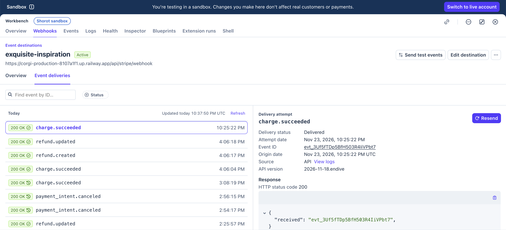
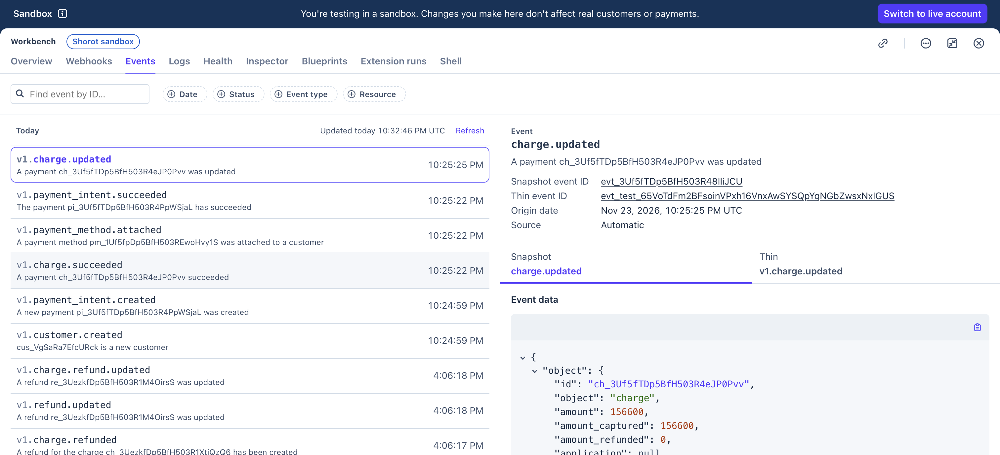
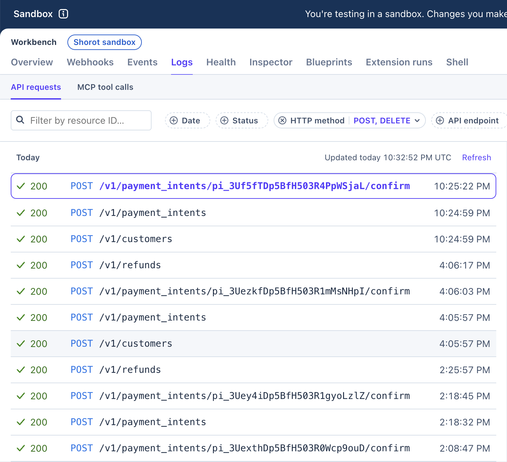
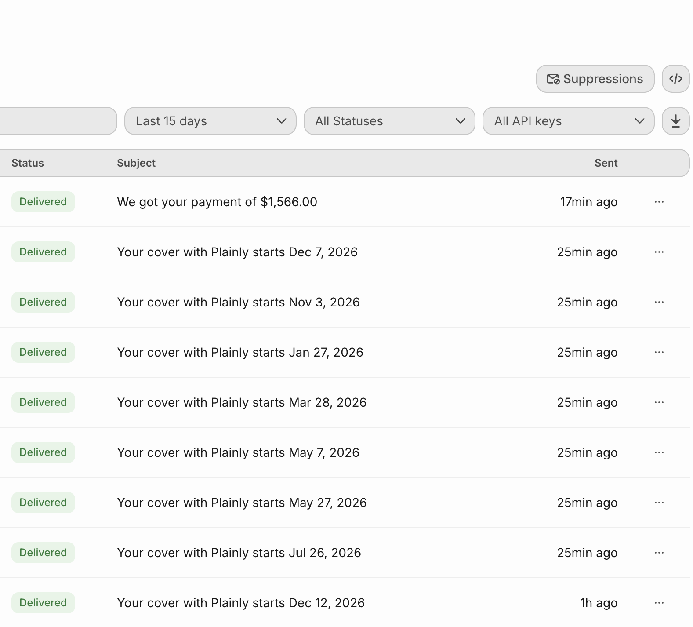

# Sandbox integration evidence

Two live sandbox integrations: **Stripe** (test mode) for payments, refunds and webhooks, and **Resend** (sandbox) for emails. Screenshots were taken on Nov 23, 2026 from the deployed app at https://corgi-production-8107a1f1.up.railway.app. What's live and what's simulated is in the [README](../../README.md#integrations-whats-live-and-whats-simulated).

One payment runs through all three Stripe screenshots: PaymentIntent `pi_3Uf5fTDp5BfH503R4PpWSjaL` for $1,566.00, settled by event `evt_3Uf5fTDp5BfH503R4IiVPbt7`.

## 1. Stripe → the app: webhook deliveries

Stripe's signed webhooks reaching the live app at `/api/stripe/webhook`: payments (`charge.succeeded`), refunds (`refund.created`, `refund.updated`) and cancelled payment attempts. Each was answered **200 OK**, and the app's reply names the event it recorded (`"received": "evt_3Uf5fT…"`). In Plainly, only these webhooks mark a payment or refund as settled, and each event id is processed once. A few deliveries failed during the first setup of the endpoint; every delivery since has returned 200.

## 2. Stripe events

The sandbox events for the same payment: the PaymentIntent created and succeeded, and the charge of $1,566.00 (`"amount": 156600`, in cents) succeeded. Below it, a return premium refunded to the card (`refund.updated`, `charge.refunded`).

## 3. The app → Stripe: API requests

Calls the app made to Stripe, all returning 200: creating the Stripe customer and the PaymentIntent, confirming the card payment, and sending refunds.

## 4. Resend: emails sent

Emails Plainly sent through Resend's sandbox, all delivered: the payment receipt for the same $1,566.00 payment, and "policy issued" emails. Resend's sandbox delivers only to the account owner, so every email goes to one test inbox and names the fictional owner it was for (the recipient column is cropped out).
